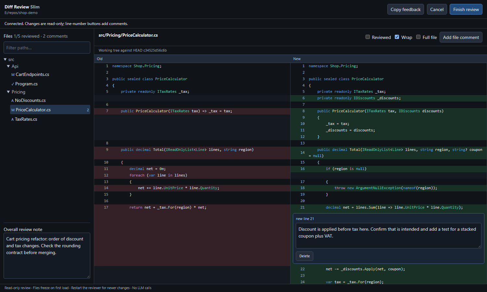

# Agent Diff Review Slim



A small, human-operated Git review tool built with .NET 10 and an existing Edge
or Chrome browser. No third-party NuGet or npm packages, LLM calls or source edits.

**Implemented:** working-tree and committed branch comparisons, browser comments,
Markdown/JSON feedback and an optional pi adapter. **Not implemented:** Claude
hook integration, last-commit/history/all-files views. Work-container compatibility
still needs verification; see [todo.md](todo.md).

## Prerequisites and build

- .NET 10 SDK to build; ASP.NET Core 10 runtime to run the published application.
- Approved Git on PATH supporting `--no-lazy-fetch`; older versions fail closed.
- An existing Edge or Chrome browser.

`NuGet.Config` clears package feeds. Nothing installs or upgrades the environment.

```sh
dotnet build AgentDiffReview.csproj -c Release
dotnet run --file checks/Program.cs -c Release
dotnet publish AgentDiffReview.csproj -c Release -o artifacts/publish
```

The dependency-free checks use disposable Git repositories and real HTTP/process
requests. Symlink tests skip when the OS denies link creation. Publish into a
fresh output directory: publishing over an old release does not remove old files.
Build separately from review launches so build output cannot become agent feedback.

## Start a review

```sh
dotnet ./artifacts/publish/diff-review-slim.dll open --repo E:/repos/your-project
```

Without a base, the comparison is **HEAD → files on disk**: staged and unstaged
changes combined into one net diff, plus untracked non-ignored files. Unlike VS
Code Source Control, it does not show staged and unstaged changes separately.
Repositories without commits are supported. Unresolved conflicts are omitted.

For a committed branch comparison:

```sh
dotnet ./artifacts/publish/diff-review-slim.dll open --repo E:/repos/your-project --base main
```

This compares the **merge base → HEAD**, excluding dirty and untracked files.
`open main` is an alias. Refs must resolve locally or under `origin`; no fetch,
including implicit lazy fetching, is performed. Obtain missing objects separately
through your approved Git workflow.

On Windows, launch tries Edge app mode; `--browser chrome` selects Chrome.
`--no-open` disables launch. Elsewhere, or if launch fails, open the URL printed
to stderr manually. See `--help` for all options.

### Browser behaviour

- Split old/new diff, stacked on narrow windows; click line numbers to comment.
- File comments, overall note, reviewed markers and comment counts.
- Fuzzy path filter, wrapping and expandable unchanged context.
- Copy feedback uses the server's Markdown formatter; Finish submits it.
- Files **freeze on first load**, including across reloads. Restart to see edits.
  A size/mtime change between indexing and capture produces an omission. This is
  not an atomic checkout snapshot, and Git is not locked.
- Reload recovery stores the token and draft in tab-scoped `sessionStorage`, not
  source contents. Storage may be disk-backed. It cannot recover a stopped or
  expired session; unavailable storage disables recovery with a warning.

### Feedback contract

- Non-empty submission: Markdown on stdout, exit `0`.
- Cancel, close/disconnect, empty submission, timeout or error: non-zero exit.
- URLs and diagnostics go to stderr. No feedback is intentionally written to
  stdout before submission. **Discard any partial output unless exit is `0`.**
- One terminal action per session. If the acknowledgement is lost, inspect the
  CLI outcome rather than assuming success or resubmitting. Browsers may refuse
  automatic window closing; close a completed window manually.

For versioned JSON and atomic file output:

```sh
dotnet ./artifacts/publish/diff-review-slim.dll open --repo E:/repos/your-project --format json --out E:/temp/review.json
```

`--out` writes **instead of stdout**; its parent directory must exist. Output
includes repository/commit identity, paths, side/line ranges and captured-content
hashes where available. File output is written to a unique temporary sibling,
then renamed into place. A forced exit can leave partial stdout or temporary files.

## Optional pi adapter

Publish first, then start a **new, idle pi session** in the checkout to review:

```sh
pi --extension /path/to/agent-diff-review-slim/integrations/pi.ts
```

Run `/diff-review-slim` or `/diff-review-slim main`. It reviews pi's working folder.
Successful feedback is appended to the editor as a **draft**, never auto-sent or
added to model context. Cancel, empty feedback or errors leave the editor alone.
Escape in the waiting screen or `/diff-review-slim-cancel` cancels the reviewer;
session shutdown/reload also cancels it, without killing shared browser processes.

The adapter uses the existing pi installation, not extra packages or global config.
Its default DLL is `artifacts/publish/diff-review-slim.dll` relative to this repo.
Override with `DIFF_REVIEW_SLIM_DLL`; set `DIFF_REVIEW_SLIM_NO_OPEN=1` for manual URLs.
The private URL appears in pi's UI; RPC clients must not log or share it.

Optional integration checks require existing Python 3 and pi, but no model turn:

```sh
python checks/pi-smoke.py
```

`--pi` and `--dll` override locations. These checks do not prove Claude hook
compatibility. Interactive pi acceptance remains in [todo.md](todo.md).

## Containers, WSL and cancellation

Run .NET beside the checkout and Git, then use approved **private** host forwarding:

```sh
dotnet /path/to/publish/diff-review-slim.dll open \
  --repo /workspace/your-project --port 43127 \
  --public-url http://localhost:43127/ --no-open
```

Use the host-facing port in `--public-url` if different. The URL must be HTTP
loopback, without credentials, path, query or fragment. The default bind is
`127.0.0.1`. Add `--listen 0.0.0.0` only if forwarding requires it, keeping the
host-facing port private/loopback. **Never expose this server to a LAN or public
tunnel.** Automatic container-to-host browser opening is not configured.

A held-open HTTP request tracks the browser. Disconnect cancels after a default
5-second reconnect grace (`--grace-seconds`, 1–30); reload promptly to reconnect.
The overall deadline defaults to 570 seconds (`--timeout-seconds`, 1–3600), including
submission/output. Closing before the UI connects cannot be detected this way;
terminal cancellation or the deadline is the fallback. Verify disconnect behaviour
through the actual proxy/forwarding setup: local checks do not prove it.

## Safety and limits

- Launch URLs contain credentials: keep them out of logs, tickets and model
  transcripts. API calls require the random session token; the server validates
  Host/Origin, restricts content, disables caching and bounds request sizes.
- Only three fixed UI assets are served, never checkout paths or `.git`. Source
  renders via `textContent`, not HTML. Add new assets explicitly in `Program.cs`;
  the regression harness checks their reachability.
- Working-tree review refuses tracked files assigned to configured Git
  `filter.*.clean` or `filter.*.process` helpers, even when unchanged. Use a
  committed base comparison or an approved checkout without those helpers; do not
  remove required company configuration to bypass the check.
- Git operations have bounded output/time and disable external diff/textconv,
  fsmonitor and lazy fetching. Cancellation terminates active Git process trees.
  Git, PATH and configuration must be trusted and stable.
- Traversal, symlinks and ancestor reparse points are rejected. Binary, non-UTF-8,
  submodule and oversized content is explicitly omitted. This is for trusted
  developer checkouts, not a sandbox against hostile local processes swapping files.
- Limits: 1,000,000 bytes per file side, 20,000 diff rows, 10,000 indexed files and
  an estimated 32 MB retained-row budget (not total process memory). Captures are
  not evicted beneath comments; start a smaller review if the budget is reached.
- Captured source is briefly copied into temporary files for isolated Git byte
  comparisons. Hard termination cannot guarantee cleanup.

No packages does not mean automatic workplace approval. Use approved, patched
runtimes, Git and browsers. Confirm permission for temporary source copies,
browser profiles/extensions, potentially disk-backed draft storage, clipboard use,
private forwarding and any feedback sent to an agent. Claude hook integration
remains unimplemented; standalone use does not establish compatibility or approval.

## Relationship and licence

A separate work-focused implementation of
[Agent Diff Review](https://github.com/dfox97/agent-diff-review), not a replacement
of that repository or its history. Reference upstream commit:
[`7d9295b`](https://github.com/dfox97/agent-diff-review/tree/7d9295b63840e8310ef6d2e829320ed6577ff537).

[MIT](LICENSE). Preserve applicable copyright and licence notices.
